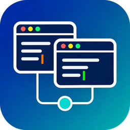

# LAN Collab

[Tiếng Việt](README.md) | English

LAN Collab lets several people edit one project in VS Code at the same time over the local network. Every machine keeps a real copy of every project file, so each member runs the program, the debugger, and their own AI tools locally while edits still reach the other machines at once.

LAN Collab has two parts:

- **LAN Hub** is the sync server. The LAN Hub app runs on a Windows machine on the LAN and serves several projects on one port. The headless `lanhub-cli` runs the same configuration on Windows or Linux, including on an external server.
- **The LAN Collab extension** for VS Code. A member pastes an invite code to join a project. The extension diagnoses its own connection problems and keeps a per-member history of edit runs.

LAN Hub needs no Internet access and no third-party service.

The user interface of the extension and of the LAN Hub app is Vietnamese. This README quotes each caption in Vietnamese, followed by its meaning.

## Contents

- [Features](#features)
- [Requirements](#requirements)
- [Install the LAN Hub app](#install-the-lan-hub-app)
- [Run LAN Hub headless](#run-lan-hub-headless)
- [Install the extension](#install-the-extension)
- [Join a project with an invite code](#join-a-project-with-an-invite-code)
- [Read the connection diagnosis](#read-the-connection-diagnosis)
- [Use the edit-run history](#use-the-edit-run-history)
- [Chat](#chat)
- [Extension commands and settings](#extension-commands-and-settings)
- [Work with Git](#work-with-git)
- [How sync works](#how-sync-works)
- [Security](#security)
- [Known limitations](#known-limitations)
- [Troubleshooting](#troubleshooting)
- [Development](#development)
- [License](#license)

## Features

- **Real-time concurrent editing.** Each keystroke reaches the other machines at once. Members who edit the same file converge on the same text through Operational Transformation (OT).
- **Real files on every machine.** Changes that AI tools, scripts, or Git write straight to disk are detected, merged with unsaved edits, and synced.
- **One LAN Hub, many projects.** Each project has its own token, allow list, and invite code. Adding, editing, or pausing one project does not interrupt the others.
- **Self-diagnosing connection.** The extension tries every address of the LAN Hub in parallel and finds the LAN Hub again on the LAN when its address changes. When it cannot connect, it says which step failed and what to do.
- **Edit-run history.** LAN Hub records each edit run of each member. A member views the text after a run next to the current file, copies from it, reverts only that run, or restores a deleted file.
- **Team awareness.** Each member's cursor and selection in their own color, a member list with the file and line each member is on, an activity feed, and a follow mode.
- **Chat inside VS Code.** `@name` mentions, clickable `file:line` references, images, and chat history kept on the LAN Hub.
- **Survives disconnects.** Members keep editing while offline. On reconnect, both sides are merged three ways. Files changed on both sides are listed so the member picks which version to keep.

## Requirements

| Component | Requirement |
|---|---|
| LAN Hub app | Windows 10 or 11, 64-bit. The installer installs WebView2 when the machine lacks it |
| `lanhub-cli` | Windows 64-bit, or Linux x86_64 |
| Extension | VS Code 1.80 or later |
| Network | Member machines reach the LAN Hub machine on TCP port 8200. Finding the LAN Hub on the LAN uses UDP port 8201 |

Extension 0.2 works only with LAN Hub 0.2. A team on LAN Collab 0.1 follows the upgrade guide in [docs/upgrade-0.2.md](docs/upgrade-0.2.md) (Vietnamese).

## Install the LAN Hub app

Install the LAN Hub app on a machine that stays on in the LAN. That machine holds the hub copy of every project.

### Install

1. Download `LanHub_<version>_x64-setup.exe` from the repository's Releases page.
2. Run the installer. It installs for the signed-in Windows user and needs no administrator rights.
3. The installer is not code-signed, so Windows SmartScreen may block it. Click **More info**, then **Run anyway**.
4. Start **LAN Hub** from the Start menu.

On the first run, the window shows an empty project list with two buttons: **Thêm dự án** (add project) and **Nhập từ LAN Hub 0.1…** (import from LAN Hub 0.1). The configuration is stored in `%APPDATA%\LanHub\lanhub.toml`.

### Add a project

1. Click **Thêm dự án**.
2. Enter **Tên dự án** (project name). Members see this name when they join.
3. Click **Chọn thư mục…** (choose folder) and select the project's source folder. LAN Hub syncs every file in it except the exclude patterns.
4. Keep **Phục vụ dự án** (serve the project) on. Keep **Quảng bá trong mạng LAN** (advertise on the LAN) on to show the project name when members look for a LAN Hub on the LAN.
5. Click **Thêm dự án**.

LAN Hub generates a random token for the project and starts serving it at once. Open the project to see its tabs:

| Tab | Content |
|---|---|
| **Tổng quan** (overview) | Member count, file count, last activity, folder, state |
| **Truy cập** (access) | The token (show, copy, rotate) and the allow list, one account per line as `github:name` or `microsoft:email`. An empty list lets every token holder in |
| **Đồng bộ** (sync) | Exclude patterns, with a list of the files they match |
| **Lịch sử** (history) | Limits of the edit-run history (idle time, days kept, maximum size) and **Dọn lịch sử ngay** (prune now) |
| **Mã mời** (invite) | The `LC3-` invite code with a QR code and **Sao chép mã mời** (copy invite code) |
| **Thành viên** (members) | Connected members, their IP address, open file, and latency |
| **Nhật ký** (log) | The project log, with search, filters, and **Xuất nhật ký…** (export) |
| **Cài đặt** (settings) | Rename, change the folder, pause, or **Xoá dự án** (delete). Deleting a project deletes no file |

Rotating the token invalidates every earlier invite code of the project. Connected members need a new invite code.

### Open the firewall

Windows blocks connections from other machines to LAN Hub until a firewall rule allows them.

1. In the LAN Hub app, click the gear icon **Cài đặt LAN Hub** (LAN Hub settings) at the top of the window.
2. On the **Tường lửa Windows** (Windows firewall) card, click **Mở tường lửa** (open firewall).
3. Windows asks for administrator rights once. Click **Yes**.

The app adds the rule `LAN Hub TCP 8200` for the connection port and `LAN Hub UDP 8201` for LAN discovery, using the configured ports. The card shows the state of each port: open, not open, rule disabled, or blocked. **Sao chép lệnh** (copy command) copies the matching `netsh` commands to run by hand. Member machines need no open port.

### Start at sign-in and the tray

- On the **Khởi động** (startup) card of **Cài đặt LAN Hub**, turn on **Chạy LAN Hub khi đăng nhập Windows** (run LAN Hub at Windows sign-in). LAN Hub then runs hidden in the system tray and serves its projects without opening a window.
- Closing the window minimizes LAN Hub to the tray, and it keeps serving. The tray menu opens the window, pauses or resumes each project, copies an invite code, and quits. **Thoát** (quit) writes every pending file before it stops.
- One LAN Hub app runs per machine. Starting it again brings the running window forward.

### LAN Hub settings

**Cài đặt LAN Hub** applies changes as soon as you click **Lưu cài đặt** (save), with no restart:

- **Tên LAN Hub**: the name members see. Blank means the computer name.
- **Địa chỉ nhận kết nối** and **Cổng TCP**: the bind address and TCP port, `0.0.0.0` and `8200` by default.
- **Cho máy khác tự tìm LAN Hub** and **Cổng UDP để tìm LAN Hub**: LAN discovery, on and `8201` by default.
- **Địa chỉ công khai** (public address) and **Mã hoá kết nối bằng TLS** (TLS): for members who connect from outside the LAN. See [docs/lanhub-server.md](docs/lanhub-server.md).

**Thêm LAN Hub từ xa** (add remote LAN Hub) manages a `lanhub-cli` on another machine the same way as the local LAN Hub. [docs/lanhub-server.md](docs/lanhub-server.md) explains how to turn on remote admin.

### Check from a browser

While LAN Hub runs, open `http://<LAN Hub machine IP>:8200/` in a browser on a member machine. The page shows the LAN Hub name, its version, and its advertised projects. If the page opens, the network and the firewall work and any remaining fault is on the extension side. A LAN Hub with TLS on still answers this page over `http://`.

## Run LAN Hub headless

`lanhub-cli` is LAN Hub without a window, for servers or for machines where you do not want the app. It reads the same `lanhub.toml` format as the app and applies the file again whenever it changes.

1. Download `lanhub-cli-<version>-<platform>.zip` (Windows) or `lanhub-cli-<version>-x86_64-unknown-linux-gnu.tar.gz` (Linux) from the Releases page and extract it.
2. Write `lanhub.toml` from the reference below.
3. Check the configuration, the ports, and the firewall without changing anything:

   ```
   lanhub-cli --diagnose --config lanhub.toml
   ```

4. Start LAN Hub:

   ```
   lanhub-cli --config lanhub.toml
   ```

   Each project logs one `Mã mời: LC3-...` line at start. Send that code to the members.

Without `--config`, `lanhub-cli` reads `%APPDATA%\LanHub\lanhub.toml` on Windows and `$XDG_CONFIG_HOME/lanhub/lanhub.toml` (by default `~/.config/lanhub/lanhub.toml`) on Linux. To run it as a systemd or Windows service, and to set up TLS, public addresses, and remote admin, follow [docs/lanhub-server.md](docs/lanhub-server.md) (Vietnamese).

### `lanhub.toml` reference

A complete commented example is [`lanhub/examples/lanhub.toml`](lanhub/examples/lanhub.toml). A key that is not in this table is an error. Relative paths are relative to the folder of the file.

| Key | Default | Meaning |
|---|---|---|
| `[hub] name` | computer name | LAN Hub name that members see |
| `[hub] bind` | `"0.0.0.0"` | Bind address |
| `[hub] port` | `8200` | TCP port shared by every project |
| `[hub] discovery` | `true` | Answer the extension when it looks for a LAN Hub on the LAN |
| `[hub] discovery_port` | `8201` | UDP port for LAN discovery |
| `[hub] public_address` | `[]` | Public host names or IP addresses. Invite codes list them first |
| `[hub.tls] enabled` | `false` | Turn on TLS. Invite codes carry the certificate fingerprint |
| `[hub.tls] cert`, `key` | none | An existing PEM certificate and key, always together. Without them LAN Hub generates a self-signed certificate once |
| `[hub.admin] remote` | `false` | Turn on remote admin |
| `[hub.admin] token`, `token_sha256` | none | Admin token (at least 16 characters) or its SHA-256. Set only one |
| `[[project]] name` | required | Project name, compared without regard to case |
| `[[project]] root` | required | Project folder |
| `[[project]] enabled` | `true` | `false` pauses the project |
| `[[project]] token` | `""` | Project token. An empty string lets every machine on the network join |
| `[[project]] allow` | `[]` | Allow list. Empty lets every token holder in |
| `[[project]] allow_file` | none | An allow-list file from LAN Collab 0.1, added to `allow` |
| `[[project]] exclude` | `[]` | Exclude patterns, added to the defaults |
| `[[project]] advertise` | `true` | Show the project name in LAN discovery |
| `[project.history] enabled` | `true` | Record the edit-run history |
| `[project.history] idle_minutes` | `15` | An edit run ends after this many minutes without an edit |
| `[project.history] keep_days` | `30` | Older edit runs are deleted |
| `[project.history] max_mb` | `2048` | Maximum history size of the project |

Default exclude patterns: `.git`, `.lan-collab`, `.venv`, `venv`, `node_modules`, `__pycache__`, `*.pyc`, `*.lc-tmp`, `~$*`, `.DS_Store`, `Thumbs.db`.

## Install the extension

1. Download `lan-collab-<version>.vsix` from the Releases page.
2. Install it from a terminal:

   ```
   code --install-extension lan-collab-<version>.vsix
   ```

   Or in VS Code: **Extensions**, the `···` menu, **Install from VSIX…**.

The activity bar gets a **LAN Collab** icon. While not connected, the **Bắt đầu** (start) view links to **Thiết lập kết nối** (connection setup) and **Tham gia bằng mã mời** (join with invite code). The **Bắt đầu với LAN Collab** walkthrough in VS Code covers getting an invite code, joining, checking the connection, chat, and history.

To update, install the new `.vsix` the same way. VS Code replaces the old version.

## Join a project with an invite code

An invite code starts with `LC3-`. It holds every IPv4 address of the LAN Hub machine, the port, the project name, the token, and the certificate fingerprint when the LAN Hub uses TLS.

1. Get an invite code from one of these places:
   - The LAN Hub app: open the project, tab **Mã mời**, click **Sao chép mã mời**.
   - The LAN Hub tray menu: **Sao chép mã mời**.
   - A connected member: run **LAN Collab: Sao chép mã mời** (copy invite code).
2. On the new machine, open an empty folder in VS Code, or no folder.
3. Press `Ctrl+Shift+P`, run **LAN Collab: Tham gia bằng mã mời** (join with invite code), and paste the code.
4. The extension checks the code with the LAN Hub before it writes any file.
5. If the open folder is not empty, choose or create an empty folder for the project. VS Code opens it.
6. The extension connects and downloads the whole project. The status bar shows **Đang đồng bộ** (syncing), then the member count once it is ready.

A joined folder remembers its LAN Hub on that machine, so it connects by itself the next time it opens. The token is kept in the operating system's secret store, not in settings.

Joining into a folder that already has files opens the sync panel before anything is written. The panel lists every file that differs from the hub copy. For each file, choose **Bản trên hub** (hub copy), **Bản trên máy này** (this machine's copy), or **Gộp** (merge), and use **So sánh** (compare) to see both. Replaced files are backed up to `.lan-collab/backup/`, and **LAN Collab: Khôi phục từ bản sao lưu** (restore from backup) brings them back.

An invite code that starts with `LC-` comes from LAN Collab 0.1. Extension 0.2 does not read it and changes no file. Get a new invite code from the LAN Hub app.

When an invite code is not available, open **LAN Collab: Thiết lập kết nối**. It accepts a pasted invite code, a LAN Hub found on the LAN, or an address, port, project, and token typed by hand.

## Read the connection diagnosis

### Status bar

| Status bar text | Meaning |
|---|---|
| `LAN Collab` | Not connected |
| **Đang tìm LAN Hub**, **Đang kết nối**, **Đang đồng bộ** | Looking for the LAN Hub, connecting, syncing |
| **4 thành viên** | Connected, syncing in real time, with 4 members |
| **Mất kết nối** | Connection lost. Reconnecting after 1, 2, 5, 10, then 30 seconds. Edits on this machine are sent on reconnect |
| **Chưa kết nối được** | Not connected yet in this session. The extension keeps retrying |
| **Cần xử lý** | The LAN Hub refused the connection. The notification states the reason and offers a fix |

Click the status bar to open the LAN Collab menu.

### Connection diagnosis

On each reconnect, the extension tries every known address in parallel. When no address answers, it looks for the LAN Hub on the LAN by the id in the invite code. If it finds the LAN Hub at a new address, it saves that address and connects.

When it still cannot connect, run **LAN Collab: Chẩn đoán kết nối** (diagnose connection), or click **Chẩn đoán** on the error notification or in the **Kết nối LAN Hub** panel. The command runs eight steps in order and marks each one as passed, fixed automatically, failed, or skipped:

1. **Cấu hình thư mục**: the folder has a LAN Hub.
2. **Kết nối tới địa chỉ đã biết**: tries every address in the invite code and the last address that worked, 3 seconds each.
3. **Tìm LAN Hub trong mạng LAN**: looks for the LAN Hub over UDP when step 2 fails.
4. **Đường mạng tới LAN Hub**: classifies the network error.
5. **Vân tay TLS**: compares the LAN Hub certificate with the fingerprint in the invite code.
6. **Phiên bản, dự án, token và tài khoản**: checks that the LAN Hub accepts this machine.
7. **Thư mục dự án**: checks that the folder is writable and does not belong to another project.
8. **Độ trễ tới LAN Hub**: measures the latency.

**Sao chép báo cáo** (copy report) copies the results with the versions and network adapters, with the token and invite codes masked, to send to the LAN Hub administrator.

### What each failure means

| Diagnosis result | Cause | What to do |
|---|---|---|
| The folder has no LAN Hub | The folder has not joined a project | Run **Tham gia bằng mã mời** |
| LAN Hub is not running or the port is wrong | The LAN Hub machine refuses connections on that port | Open the LAN Hub app and check that the project runs. Check that the port in the invite code matches **Cổng TCP** of the LAN Hub |
| The port does not answer within 3 seconds | The firewall on the LAN Hub machine blocks the port, the two machines are on different subnets, or a VPN is on | Click **Mở tường lửa** in the LAN Hub app. Turn off the VPN. Open `http://<IP>:8200/` in a browser to test the network |
| This machine has no route to the address | The two machines are on different networks | Connect both machines to the same LAN and turn off the VPN |
| No LAN Hub found on the LAN | LAN Hub is not running, LAN discovery is off, or a firewall blocks UDP 8201 | Check that LAN Hub runs and that the rule `LAN Hub UDP 8201` exists. Or paste a new invite code with the current address |
| The folder has no LAN Hub id to search for | The folder was set up by hand and never connected | Paste a new invite code |
| The TLS certificate differs from the fingerprint in the invite code | The LAN Hub changed its certificate, or another machine sits in between | The extension stops and never skips this check. Get a new invite code from the LAN Hub administrator |
| The port accepts connections but does not speak the LAN Hub protocol | Another program uses that port | Check the address and port in the invite code |
| LAN Hub refuses this machine's token | The token changed or the invite code is old | **Dán mã mời mới** (paste a new invite code) or **Nhập token** (enter token) |
| LAN Hub has no such project | The project name is wrong, or the project was deleted or paused | **Chọn dự án** (choose a project) from the LAN Hub's list, or paste a new invite code |
| LAN Hub accepts only accounts on the allow list | The project has an allow list and VS Code is not signed in | **Đăng nhập** (sign in) to GitHub or Microsoft in VS Code |
| The account is not on the allow list | The LAN Hub administrator has not added it | **Sao chép dòng** (copy line) and send it to the LAN Hub administrator, who adds it on the **Truy cập** tab. Or **Đổi tài khoản** (switch account) |
| LAN Hub uses a newer or older protocol version | The extension and the LAN Hub have different versions | Update the older side. Extension 0.2 needs LAN Hub 0.2 |
| The folder is not writable | The folder is read-only | Grant write access or choose another folder |
| The folder belongs to another LAN Hub's project | The folder is already bound to another LAN Hub | Choose an empty folder |

When a network step fails, the **Kết nối LAN Hub** panel also offers **Thử lại** (retry), **Tìm lại LAN Hub** (find the LAN Hub again), and **Hướng dẫn mở tường lửa** (firewall guide) with PowerShell commands for the LAN Hub machine.

## Use the edit-run history

An edit run is one member's consecutive changes to one file. A run ends when another member edits the file, when its author stops editing for 15 minutes, when the file is deleted or renamed, or when LAN Hub stops. LAN Hub stores the file content at the start and the end of each run, with the source of the change: typed in the editor, written by a tool outside the editor, a revert, or a merge on reconnect.

Open the **Lịch sử chỉnh sửa** (edit history) view in the LAN Collab sidebar, run **LAN Collab: Xem lịch sử chỉnh sửa**, or press `Ctrl+Alt+L`, then `H`. Choose **File đang mở** (open file) or **Toàn dự án** (whole project). Each row shows the author, the time, the source, and the characters added and removed. A run still in progress has the **Đang sửa** (editing) label.

Select a run to get its actions:

- **Mở bản sau lượt chỉnh sửa** (open the text after the run): opens the file as it was right after the run, read-only. Double-clicking the row does the same.
- **So sánh với bản hiện tại** and **So sánh với bản trước đó** (compare with the current text, compare with the text before): open the VS Code side-by-side diff.
- **Sao chép nội dung** (copy content): copies the whole text after the run. In the read-only window, select and copy any part.
- **Hoàn tác lượt chỉnh sửa này** (revert this run): removes only that run's changes and keeps later changes, like `git revert`. The extension opens a preview, then asks for confirmation. The result syncs to every member and becomes a new edit run with the revert source. Parts that were edited again later stay as they are, and the confirmation counts them.
- **Khôi phục file** (restore file): for a deletion run, creates the file again from its content at deletion.
- **Khôi phục phiên bản này** (restore this version): for a binary file, replaces the current file with that version. The current version stays in the history.

The history lives in `.lan-collab/history/` in the project folder on the LAN Hub machine. By default it keeps 30 days and at most 2 GB per project. The LAN Hub administrator changes the limits on the **Lịch sử** tab.

## Chat

Open the **Chat** view in the LAN Collab sidebar, or press `Ctrl+Alt+L`, then `C`.

- Enter sends and Shift+Enter starts a new line. A message holds up to 4000 characters.
- Type `@` to pick a member to mention. The mentioned member gets a notification.
- Any `path/to/file.ext:line` text opens that file at that line. A composer button inserts the file and line of the active editor.
- Send PNG, JPEG, GIF, or WebP images up to 4 MB with Ctrl+V or the file picker. Large images are scaled down before sending.
- Web links, `code`, code blocks, and an emoji picker are supported.

Chat history is stored in the project's `.lan-collab/history/` on the LAN Hub machine.

## Extension commands and settings

| Command | Meaning |
|---|---|
| **LAN Collab: Tham gia bằng mã mời** | Join a project with an invite code |
| **LAN Collab: Sao chép mã mời** | Copy the invite code of the open project |
| **LAN Collab: Thiết lập kết nối** | Open the **Kết nối LAN Hub** panel |
| **LAN Collab: Chẩn đoán kết nối** | Run the eight diagnosis steps |
| **LAN Collab: Kết nối**, **Ngắt kết nối** | Connect or disconnect the open folder |
| **LAN Collab: Xem lịch sử chỉnh sửa** | Open the edit history view |
| **LAN Collab: Mở chat** | Open the chat view |
| **LAN Collab: Đi theo thành viên**, **Thôi đi theo** | Follow a member's file and line, stop following |
| **LAN Collab: Đặt trạng thái** | Set a status line that other members see |
| **LAN Collab: Chọn tài khoản VS Code** | Pick the GitHub or Microsoft account used as the display name |
| **LAN Collab: Khôi phục từ bản sao lưu** | Restore files from `.lan-collab/backup/` |
| **LAN Collab: Xem nhật ký** | Open the "LAN Collab" Output channel |
| **LAN Collab: Mở menu** | Open the LAN Collab menu, as the status bar does |

| Setting | Default | Meaning |
|---|---|---|
| `lanCollab.server` | `""` | LAN Hub address as `IP:port`. Not needed for a folder joined with an invite code |
| `lanCollab.project` | `""` | Project name on the LAN Hub |
| `lanCollab.token` | `""` | LAN Hub token. At startup the extension moves it into the operating system's secret store and removes it from settings |
| `lanCollab.name` | `""` | Display name. Blank means the VS Code account name, or `windows-user@computer` |
| `lanCollab.autoConnect` | `true` | Connect when a folder bound to a LAN Hub opens |
| `lanCollab.autoSave` | `true` | Save the open file about 0.4 seconds after each change, so the disk copy on every machine stays current |
| `lanCollab.exclude` | `[]` | Glob patterns that are not synced, added to the defaults |

Exclude files that each machine generates when it runs the program, such as output files and build folders, so the machines do not overwrite each other's results.

## Work with Git

The `.git` folder is not synced. Every machine has the same working tree, so one member commits:

1. The committing member runs `git add`, `git commit`, and `git push` as usual.
2. The other machines run `git fetch`, then `git reset origin/<branch>` without `--hard`. That command moves HEAD and the index to the new commit, because the working tree already matches it.

`git checkout`, `git pull`, or `git stash` on one machine changes many files, and those changes sync to every machine. To work alone on another branch, disconnect first. On reconnect, files changed only on that machine are sent, and files changed on both sides appear in the sync panel for you to choose.

## How sync works

| Data | How it syncs |
|---|---|
| UTF-8 text files up to 1 MB | Operation by operation, with OT. The LAN Hub orders the operations |
| Binary files, or files over 1 MB | The whole file on save. Earlier versions stay in the edit-run history |
| Disk changes by outside tools | Detected by a file watcher and merged three ways with the unsaved text |
| Line endings | One style per file, CRLF or LF, whichever the file uses most |
| UTF-8 BOM | Kept |
| Disconnect while VS Code stays open | Both sides are merged three ways on reconnect |
| Changes while the extension is not running | On the next connect, files changed only locally are sent, files changed only on the LAN Hub are downloaded, and files changed on both sides appear in the sync panel |
| File deleted while another member edits it | The file is created again so the edits are not lost |
| File rename | Handled as a delete and a create, also when only the case changes |

## Security

- **Encryption.** By default, connections on the LAN are not encrypted. Use LAN Collab only on a trusted network, over a VPN, or with TLS on. With TLS on, the invite code carries the certificate fingerprint, and the extension checks it before it sends the token.
- **Token.** The token is the main access control. Invite codes contain the token, so send them only to team members. Rotate the token on the **Truy cập** tab when an invite code leaks.
- **Allow list.** LAN Hub does not verify accounts with GitHub or Microsoft, because LAN Hub needs no Internet and the extension sends no sign-in token. The list stops accidental joins. It does not stop a token holder who claims a false account.
- **Token on member machines.** The token is kept in the operating system's secret store through VS Code SecretStorage. Tokens from LAN Collab 0.1 move there on the first run.
- **What the extension sends.** Besides file content, the extension sends only the display name, the account name if any, the cursor position, the status line, and chat messages.
- **Paths.** LAN Hub and the extension refuse paths outside the project folder and other Windows spellings of one name, such as 8.3 short names like `GIT~1`, names that end with a dot, `name:stream`, and device names such as `CON` and `NUL`.
- **Connections that never sign in.** LAN Hub closes a connection that sends no valid hello within 15 seconds, or a message over 64 KB before sign-in.
- **Remote admin** is off by default. When it is on, the admin channel uses its own token, requires TLS from any other machine, and blocks an address after five wrong tokens in one minute.

## Known limitations

- Ctrl+Z undoes from each machine's own editor history, so it can undo a change just received from another member at the same place. To remove one member's change, use **Hoàn tác lượt chỉnh sửa này**.
- Each VS Code window syncs only the first root folder of the workspace.
- LAN Hub writes changes to disk every 0.5 seconds. A sudden power loss on the LAN Hub machine can lose the changes of that interval. A normal quit loses nothing.
- The user interface of the extension and of the LAN Hub app is Vietnamese only.
- Files with 8.3-style names, names that end with a dot or a space, or Windows device names are not synced.
- Files over about 300 MB cannot be transferred, because a file travels in one message.
- The LAN Hub installer is not code-signed, so SmartScreen may warn about it.
- The 10-minute file snapshots of LAN Collab 0.1 are no longer made and are not converted to edit runs. The old files stay in `.lan-collab/history/`.

## Troubleshooting

| Symptom | What to do |
|---|---|
| The status bar shows **Mất kết nối** or **Chưa kết nối được** | Run **LAN Collab: Chẩn đoán kết nối** and follow [What each failure means](#what-each-failure-means) |
| Members on other machines cannot connect, the LAN Hub machine can | Click **Mở tường lửa** in the LAN Hub app. Open `http://<IP>:8200/` from a member machine |
| The invite code is reported as a LAN Collab 0.1 code | Get a new invite code from the LAN Hub app, tab **Mã mời** |
| The LAN Hub machine changed its IP address | The extension finds the LAN Hub again over UDP 8201. If a firewall blocks UDP 8201, paste a new invite code |
| No account appears when picking an account | Sign in to GitHub or Microsoft through the VS Code accounts icon, then run **Chọn tài khoản VS Code** |
| The edit history view says the LAN Hub does not support it | History is off for the project, or the project folder is on a network drive where SQLite cannot open. Check the project's **Nhật ký** tab |
| The LAN Hub app shows no window | LAN Hub runs hidden in the tray. Click its tray icon |
| More detail is needed | **LAN Collab: Xem nhật ký** on the member machine, the **Nhật ký** tab in the LAN Hub app |

## Development

You need Node.js 22 or later and the Rust toolchain from `lanhub/rust-toolchain.toml` (the Windows GNU toolchain on Windows).

```
npm ci
cargo build -p lanhub-cli --release --manifest-path lanhub/Cargo.toml
npm test
```

| Command | What it does |
|---|---|
| `npm test` | Node tests, then the black-box suite in `test/conformance/` against the release `lanhub-cli` |
| `LANHUB_TLS=1 npm run test:conformance` | The black-box suite with the TLS cases |
| `npm run test:vscode` | Runs inside a real VS Code with a temporary profile, against the release `lanhub-cli` |
| `npm run build:webviews`, `npm run test:webviews`, `npm run check:webviews` | Build, vitest, and svelte-check for the extension webviews |
| `cargo test --workspace --manifest-path lanhub/Cargo.toml` | Rust tests |
| `npm run hub -- --config <file>` | Runs `lanhub-cli` from source |
| `npm run package` | Packages the extension as `dist/lan-collab-<version>.vsix` |
| `npm run package:hub` | Packages the LAN Hub installer and `lanhub-cli` into `dist/` |
| `npm run package:all` | Both |

The tests start `lanhub-cli` from `lanhub/target/release/`, or from `$CARGO_TARGET_DIR/release/` when that variable is set. `LANHUB_CMD` points them at another build. Set `LAN_COLLAB_DEBUG=1` before starting VS Code to have the extension log to the extension host console.

| Path | Content |
|---|---|
| `lanhub/` | The LAN Hub Cargo workspace: `lanhub-ot`, `lanhub-protocol`, `lanhub-core`, `lanhub-cli`, and the Tauri app in `app/` |
| `extension/src/` | The extension host |
| `extension/webview-src/` | Svelte webviews: chat, members, connection, history |
| `extension/i18n/vi.json` | Every user-facing string of the extension |
| `lib/` | Shared client code: OT, sync, the connection state machine, diagnosis |
| `packages/ui-kit/` | CSS tokens and Svelte components shared by the extension and the LAN Hub app |
| `packages/protocol/` | TypeScript types generated from `lanhub-protocol` |
| `test/` | Node tests, black-box tests, and VS Code tests |
| `tools/` | String lint, load generator, packaging, CDP control of VS Code and LAN Hub |
| `docs/protocol.md` | The protocol specification |
| `docs/copy-guide.md` | Rules for user-facing text |

## License

Released under the [MIT](LICENSE) license.
