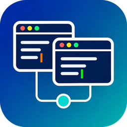

# LAN Collab

Tiếng Việt | [English](README.en.md)

LAN Collab là extension VS Code và hub đồng bộ chạy trong mạng nội bộ, cho phép nhiều người cùng sửa một dự án theo thời gian thực. Khác với các giải pháp chia sẻ phiên làm việc, mỗi máy giữ bản sao thật của toàn bộ file dự án. Vì vậy mỗi người có thể tự chạy chương trình, dùng debugger và dùng công cụ AI của riêng mình, trong khi các thay đổi vẫn được đồng bộ ngay giữa mọi máy.

Hub là một tiến trình Node.js không phụ thuộc thư viện ngoài. Hub chạy trên máy chủ của bạn (Windows hoặc Linux/macOS) và không cần Internet hay dịch vụ bên thứ ba.

## Mục lục

- [Tính năng](#tính-năng)
- [So sánh với các giải pháp khác](#so-sánh-với-các-giải-pháp-khác)
- [Kiến trúc](#kiến-trúc)
- [Yêu cầu](#yêu-cầu)
- [Cài đặt hub](#cài-đặt-hub)
- [Cài đặt extension](#cài-đặt-extension)
- [Đóng gói bản phát hành](#đóng-gói-bản-phát-hành)
- [Tham gia dự án](#tham-gia-dự-án)
- [Sử dụng](#sử-dụng)
- [Tham chiếu cấu hình](#tham-chiếu-cấu-hình)
- [Làm việc với Git](#làm-việc-với-git)
- [Cơ chế đồng bộ](#cơ-chế-đồng-bộ)
- [Bảo mật](#bảo-mật)
- [Giới hạn đã biết](#giới-hạn-đã-biết)
- [Xử lý sự cố](#xử-lý-sự-cố)
- [Phát triển](#phát-triển)
- [Giấy phép](#giấy-phép)

## Tính năng

- **Sửa đồng thời theo thời gian thực.** Mỗi thao tác gõ được truyền tới các máy khác ngay lập tức. Nhiều người sửa cùng một file vẫn hội tụ về cùng một nội dung, nhờ thuật toán Operational Transformation (OT).
- **File thật trên mọi máy.** Mỗi máy có thể tự chạy, debug và dùng công cụ AI riêng. Thay đổi do AI, script hay công cụ bên ngoài ghi thẳng xuống ổ đĩa cũng được phát hiện, gộp với phần đang sửa dở, rồi đồng bộ đi.
- **Nhận biết hoạt động của nhóm:**
  - con trỏ và vùng chọn của từng người, mỗi người một màu, kèm tên;
  - danh sách thành viên, cho biết file và dòng mỗi người đang đứng, phiên debug đang chạy, trạng thái tự ghi;
  - nhật ký hoạt động: vào hoặc rời phòng, sửa, tạo, xoá file, bắt đầu hoặc kết thúc debug;
  - chế độ đi theo màn hình của một thành viên.
- **Chat tích hợp:**
  - nhắc tên bằng `@tên`, có thông báo cho người được nhắc;
  - tham chiếu `file:dòng` có thể bấm để mở file;
  - đếm tin chưa đọc;
  - lịch sử chat lưu trên hub.
- **Định danh bằng tài khoản VS Code.** Dùng tài khoản GitHub hoặc Microsoft đã đăng nhập sẵn trong VS Code làm tên hiển thị. Hub có thể giới hạn danh sách tài khoản được vào phòng.
- **Tham gia bằng mã mời.** Dán mã là vào phòng, toàn bộ dự án được tải về một thư mục trống mà không cần cấu hình.
- **Chịu được mất kết nối:**
  - tiếp tục sửa khi mất mạng; khi có mạng lại, thay đổi hai phía được gộp ba chiều;
  - sửa lúc extension không chạy (VS Code đã tắt) được nhận ra ở lần kết nối sau;
  - file bị sửa ở cả hai phía thì extension hỏi người dùng chọn bản giữ lại.
- **Lịch sử và sao lưu.** Hub lưu ảnh chụp định kỳ của từng file và lưu bản trước khi xoá hay ghi đè. Máy khách sao lưu bản cục bộ trước khi bị thay thế.

## So sánh với các giải pháp khác

| | Live Share | Open Collaboration Tools | LAN Collab |
|---|---|---|---|
| Máy chủ trung gian | Dịch vụ của Microsoft | Tự dựng được | Tự dựng trong LAN |
| File trên máy khách | Hệ thống file ảo | Hệ thống file ảo | File thật |
| Khách tự chạy và debug trên máy mình | Không (dùng phiên debug của host) | Không | Có |
| Công cụ dòng lệnh trên máy khách đọc được file dự án | Không | Không | Có |
| Cần máy host luôn mở VS Code | Có | Có | Không (hub chạy độc lập) |

## Kiến trúc

```
 Máy A: VS Code + extension ─┐
 Máy B: VS Code + extension ─┼── TCP (mặc định 8200) ── Hub (Node.js) ── Bản chung của dự án
 Máy C: VS Code + extension ─┘                                         + lịch sử, chat
```

- **Hub** giữ bản chung của mọi file, xếp thứ tự và biến đổi các thay đổi đồng thời, rồi ghi ra đĩa, lưu lịch sử và lịch sử chat. Giao thức là JSON phân tách theo dòng, chạy trên TCP.
- **Extension** giữ bản sao cục bộ của thư mục dự án và kết nối nó với hub:
  - với file đang mở, extension nối editor với tầng OT;
  - với file không mở, extension đọc và ghi thẳng xuống đĩa;
  - extension theo dõi ổ đĩa để phát hiện thay đổi từ bên ngoài.

## Yêu cầu

| Thành phần | Yêu cầu |
|---|---|
| Hub | Node.js 18 trở lên; Windows, Linux hoặc macOS; một cổng TCP được mở trong LAN |
| Máy khách | VS Code 1.80 trở lên. Tính năng dùng tài khoản VS Code làm tên cần bản VS Code có API `authentication.getAccounts`; với bản cũ hơn, extension dùng tên máy |
| Đóng gói extension từ mã nguồn | Node.js 18 trở lên và kết nối tới npm registry (dùng `@vscode/vsce`) |

## Cài đặt hub

### Windows

1. Đưa mã hub lên máy chủ theo một trong hai cách:
   - giải nén `lan-collab-hub-<version>.zip`, lấy từ trang Releases hoặc tự đóng gói (xem [Đóng gói bản phát hành](#đóng-gói-bản-phát-hành)), ví dụ vào `D:\lan-collab\`;
   - hoặc sao chép thư mục `hub` và `lib` của repository, giữ nguyên cấu trúc.

   Hub cần cả hai thư mục `hub` và `lib`.
2. Sửa ba dòng đầu của `hub\start-hub.bat`:
   ```bat
   set "PROJECT=MyProject"
   set "ROOT=D:\lan-collab\workspaces\MyProject"
   set "PORT=8200"
   ```
   `ROOT` là thư mục chứa bản chung của dự án. Có thể để trống, khi đó máy đầu tiên tham gia sẽ gửi dự án lên.
3. Mở cổng trên tường lửa (PowerShell, quyền Administrator):
   ```powershell
   New-NetFirewallRule -DisplayName "LAN Collab 8200" -Direction Inbound -Protocol TCP -LocalPort 8200 -Action Allow
   ```
4. Chạy `hub\start-hub.bat`. Cửa sổ in ra token và một mã mời cho mỗi địa chỉ IPv4 của máy chủ:
   ```
   Token         : 5f0c...
   ... LAN Collab hub — dự án "MyProject" — thư mục D:\lan-collab\workspaces\MyProject — cổng 8200 — 0 file
   ... Mã mời (192.168.1.10): LC-AcCoAQog...
   ```
   Đóng cửa sổ là dừng hub. Mọi thay đổi chưa ghi được lưu xuống đĩa trước khi hub thoát.

### Linux và macOS

```bash
chmod +x hub/start-hub.sh
PROJECT=MyProject ROOT=/srv/lan-collab/MyProject PORT=8200 ./hub/start-hub.sh
```

### Chạy trực tiếp

```bash
node hub/hub.js --root <thư mục> [--port 8200] [--host 0.0.0.0] [--project <tên>] [--token <token>] \
                [--allow-file <file>] [--history <thư mục>] [--exclude "mẫu1,mẫu2"]
```

| Tham số | Mặc định | Ý nghĩa |
|---|---|---|
| `--root` | (bắt buộc) | Thư mục chứa bản chung của dự án |
| `--port` | `8200` | Cổng TCP |
| `--host` | `0.0.0.0` | Địa chỉ lắng nghe |
| `--project` | tên thư mục `--root` | Tên dự án; máy khách phải dùng đúng tên này |
| `--token` | biến môi trường `LAN_COLLAB_TOKEN` | Token bắt buộc khi kết nối; để trống thì không kiểm tra |
| `--allow-file` | (không có) | File danh sách tài khoản được vào phòng |
| `--history` | `<root>/.lan-collab/history` | Thư mục lịch sử và chat |
| `--exclude` | (không có) | Mẫu glob bổ sung không đồng bộ, phân tách bằng dấu phẩy |

### Chạy như dịch vụ

Windows, dùng [NSSM](https://nssm.cc/):

```powershell
nssm install LanCollab "C:\Program Files\nodejs\node.exe"
nssm set LanCollab AppParameters "D:\lan-collab\hub\hub.js --root D:\lan-collab\workspaces\MyProject --port 8200 --project MyProject --allow-file D:\lan-collab\hub\allowed-accounts-MyProject.txt"
nssm set LanCollab AppEnvironmentExtra LAN_COLLAB_TOKEN=<token>
nssm start LanCollab
```

Linux, dùng systemd (`/etc/systemd/system/lan-collab.service`):

```ini
[Unit]
Description=LAN Collab hub
After=network.target

[Service]
ExecStart=/usr/bin/node /opt/lan-collab/hub/hub.js --root /srv/lan-collab/MyProject --port 8200 --project MyProject --allow-file /opt/lan-collab/hub/allowed-accounts-MyProject.txt
Environment=LAN_COLLAB_TOKEN=<token>
Restart=on-failure

[Install]
WantedBy=multi-user.target
```

### Tệp do hub tạo ra

| Tệp | Nội dung |
|---|---|
| `hub/token-<PROJECT>.txt` | Token, do script khởi động tạo một lần. Xoá tệp này để đổi token; mọi mã mời cũ sẽ hết hiệu lực |
| `hub/allowed-accounts-<PROJECT>.txt` | Danh sách tài khoản được vào phòng (xem [Bảo mật](#bảo-mật)) |
| `<root>/.lan-collab/hub.json` | Mã định danh của bản chung. Không xoá: máy khách dùng mã này để nhận ra đúng hub |
| `<root>/.lan-collab/history/` | Ảnh chụp từng file, tối đa 10 phút một lần, cùng bản trước mỗi lần xoá hoặc ghi đè; `chat.jsonl` là lịch sử chat |

Thư mục `.lan-collab` không bao giờ được đồng bộ sang máy khách.

## Cài đặt extension

Lấy file `lan-collab-<version>.vsix` từ trang Releases của repository, hoặc tự đóng gói theo mục [Đóng gói bản phát hành](#đóng-gói-bản-phát-hành).

Cài vào VS Code bằng một trong hai cách:

```bash
code --install-extension dist/lan-collab-0.1.0.vsix
```

hoặc trong VS Code: **Extensions** → `···` → **Install from VSIX…**

Sau khi cài, thanh hoạt động bên trái có biểu tượng **LAN Collab**, gồm hai mục **Đồng đội** và **Chat**.

Để cập nhật lên phiên bản mới, cài file `.vsix` mới theo cùng cách trên; VS Code sẽ thay bản cũ.

## Đóng gói bản phát hành

Một bản phát hành gồm hai file, cùng được tạo trong thư mục `dist/`:

| File | Dùng cho | Nội dung |
|---|---|---|
| `lan-collab-<version>.vsix` | Máy khách | Extension VS Code |
| `lan-collab-hub-<version>.zip` | Máy chủ | `hub/` (`hub.js`, `start-hub.bat`, `start-hub.sh`), `lib/`, `LICENSE`, nằm trong thư mục gốc `lan-collab-hub/` |

`<version>` lấy từ trường `version` trong `package.json`.

### Yêu cầu

- Node.js 18 trở lên (kèm npm).
- Kết nối tới npm registry khi đóng gói `.vsix`. Lệnh `npx` tải công cụ `@vscode/vsce` ở lần chạy đầu và lưu vào bộ nhớ đệm của npm.
- File `.zip` của hub được tạo bằng thư viện có sẵn của Node.js, không cần công cụ nén bên ngoài.

### Các bước

1. Lấy mã nguồn:
   ```bash
   git clone https://github.com/Ndqitisme/LAN_Collab_LiveShare.git
   cd LAN_Collab_LiveShare
   ```
2. Chạy kiểm thử (khuyến nghị trước mỗi lần phát hành):
   ```bash
   npm test
   ```
3. Đóng gói:

   | Lệnh | Kết quả |
   |---|---|
   | `npm run package` | `dist/lan-collab-<version>.vsix` |
   | `npm run package:hub` | `dist/lan-collab-hub-<version>.zip` |
   | `npm run package:all` | Cả hai file |

   Ví dụ kết quả của `npm run package:all`:
   ```
   DONE  Packaged: dist\lan-collab-0.1.0.vsix (14 files, 109 KB)
   Created dist\lan-collab-hub-0.1.0.zip (8 files)
   ```
4. Kiểm tra nhanh:
   - extension: `code --install-extension dist/lan-collab-<version>.vsix`, rồi mở lại cửa sổ VS Code và xác nhận biểu tượng LAN Collab xuất hiện;
   - hub: giải nén file `.zip` vào một thư mục tạm, rồi chạy `node lan-collab-hub/hub/hub.js --root <thư mục trống> --port 8200`; hub in ra dòng khởi động và mã mời.

### Phát hành trên GitHub

1. Tăng `version` trong `package.json` theo [Semantic Versioning](https://semver.org/), commit thay đổi.
2. Chạy `npm run package:all`.
3. Tạo tag và đẩy lên:
   ```bash
   git tag v0.1.0
   git push origin v0.1.0
   ```
4. Trên GitHub: **Releases** → **Draft a new release**, chọn tag vừa tạo, đính kèm hai file trong `dist/`, ghi tóm tắt thay đổi, rồi bấm **Publish release**.

Thư mục `dist/` nằm trong `.gitignore`. File đóng gói chỉ được phân phối qua Releases, không commit vào repository.

## Tham gia dự án

### Bằng mã mời

Mã mời có dạng `LC-...`. Mã chứa địa chỉ hub, cổng, tên dự án và token.

1. Lấy mã ở một trong hai nơi:
   - cửa sổ hub: chọn dòng có địa chỉ IP cùng dải mạng với máy khách;
   - một máy đã ở trong phòng: menu LAN Collab trên thanh trạng thái → **Sao chép mã mời**.
2. Trên máy mới: `Ctrl+Shift+P` → **LAN Collab: Tham gia bằng mã**, rồi dán mã.
3. Extension kiểm tra mã với hub trước khi thay đổi bất kỳ file nào.
4. Chọn hoặc tạo một thư mục trống. VS Code mở thư mục đó, kết nối và tải toàn bộ dự án, có thanh tiến trình.

Thư mục đã tham gia bằng mã sẽ ghi nhớ hub của nó trên máy đó, nên các lần mở sau sẽ tự kết nối.

### Cấu hình thủ công

Thêm vào `.vscode/settings.json` của dự án:

```jsonc
{
  "lanCollab.server": "192.168.1.10:8200",
  "lanCollab.project": "MyProject",
  "files.saveConflictResolution": "overwriteFileOnDisk"
}
```

Đặt token trong User settings (`Preferences: Open User Settings (JSON)`) để không đưa token vào kho mã:

```jsonc
{ "lanCollab.token": "<token>" }
```

Khi đồng bộ, extension đã gộp các thay đổi từ bên ngoài vào editor trước khi lưu. Vì vậy `files.saveConflictResolution: overwriteFileOnDisk` là an toàn với các file được đồng bộ, và giúp VS Code không hiện hộp thoại "file trên đĩa mới hơn" trong trường hợp một công cụ ghi file đúng lúc file đó đang có thay đổi chưa lưu.

### Lần kết nối đầu tiên

Khi một thư mục kết nối lần đầu với một hub mà có thay đổi tới file cục bộ, extension hiện hộp thoại xác nhận, liệt kê số file sẽ được:

- tải về;
- ghi đè;
- gửi lên;
- xoá.

Hộp thoại không hiện nếu lần kết nối đó chỉ tải file về thư mục trống. Mọi file bị ghi đè hoặc xoá đều được sao lưu vào `.lan-collab/backup/<thời điểm>/`.

## Sử dụng

| Thành phần | Chức năng |
|---|---|
| Thanh trạng thái | Số người trong phòng, số tin chưa đọc, trạng thái kết nối. Bấm vào để mở menu |
| Mục **Đồng đội** | Mỗi thành viên kèm `file:dòng`, phiên debug và trạng thái. Bấm tên để nhảy tới vị trí của người đó; rê chuột để xem tài khoản. Mục **Hoạt động gần đây** là nhật ký của phòng |
| Mục **Chat** | Enter để gửi, Shift+Enter để xuống dòng. Nút `@tên` chèn lời nhắc; `@all` nhắc cả phòng. Nút **Vị trí** chèn `file:dòng` của editor đang mở. Mọi chuỗi dạng `đường/dẫn.ext:dòng` đều mở được bằng cách bấm vào |
| Trong editor | Con trỏ và vùng chọn của người khác theo màu riêng, tên hiển thị ở cuối dòng |

### Lệnh

| Lệnh | Mô tả |
|---|---|
| `LAN Collab: Tham gia bằng mã` | Tham gia phòng bằng mã mời |
| `LAN Collab: Sao chép mã mời` | Chép mã mời của phòng hiện tại vào clipboard |
| `LAN Collab: Kết nối` / `Ngắt kết nối` | Kết nối hoặc ngắt kết nối thư mục hiện tại |
| `LAN Collab: Đi theo một người` / `Thôi đi theo` | Màn hình tự di chuyển theo file và dòng của một thành viên |
| `LAN Collab: Đặt trạng thái (đang làm gì)` | Ghi một dòng trạng thái hiển thị cho cả phòng |
| `LAN Collab: Dùng tài khoản VS Code (GitHub/Microsoft)` | Chọn tài khoản đã đăng nhập trong VS Code để làm tên hiển thị |
| `LAN Collab: Mở chat` | Mở mục Chat |
| `LAN Collab: Xem nhật ký` | Mở kênh Output của extension |
| `LAN Collab: Menu` | Menu tổng hợp (cũng mở bằng cách bấm thanh trạng thái) |

## Tham chiếu cấu hình

| Thiết lập | Mặc định | Mô tả |
|---|---|---|
| `lanCollab.server` | `""` | Địa chỉ hub dạng `IP:cổng`. Không cần nếu thư mục đã tham gia bằng mã mời |
| `lanCollab.project` | `""` | Tên dự án trên hub. Hub từ chối kết nối nếu tên không khớp |
| `lanCollab.token` | `""` | Token của hub. Nên đặt trong User settings |
| `lanCollab.name` | `""` | Tên hiển thị. Để trống: dùng tên tài khoản VS Code; nếu chưa đăng nhập thì dùng `tài-khoản-hệ-điều-hành@tên-máy`. Chỉ đặt được trong User settings |
| `lanCollab.autoConnect` | `true` | Tự kết nối khi mở thư mục đã gắn với hub |
| `lanCollab.autoSave` | `true` | Tự lưu file đang mở khoảng 0,4 giây sau mỗi thay đổi, để bản trên đĩa của mọi máy luôn cập nhật |
| `lanCollab.exclude` | `[]` | Mẫu glob bổ sung không đồng bộ, ví dụ `["output.csv", "build/**"]` |

Danh sách không đồng bộ mặc định: `.git`, `.lan-collab`, `.venv`, `venv`, `node_modules`, `__pycache__`, `*.pyc`, `~$*` (file khoá của Microsoft Office), `.DS_Store`, `Thumbs.db`. Mẫu không chứa `/` áp dụng ở mọi cấp thư mục. Nên loại trừ những file mà mỗi máy tự sinh ra khi chạy chương trình (kết quả chạy, thư mục build), để kết quả của các máy không ghi đè lên nhau.

## Làm việc với Git

Thư mục `.git` không được đồng bộ. Vì mọi máy có cùng nội dung thư mục làm việc, chỉ cần một người thực hiện commit:

1. Người commit: `git add`, `git commit`, `git push` như bình thường.
2. Các máy khác: `git fetch` rồi `git reset origin/<nhánh>`, không dùng `--hard`. Lệnh này chỉ dời HEAD và index tới commit mới; thư mục làm việc vốn đã giống nội dung của commit đó.

Các thao tác thay đổi nhiều file như `git checkout`, `git pull`, `git stash` trên một máy sẽ được đồng bộ tới mọi máy. Muốn làm việc riêng trên một nhánh khác, hãy ngắt kết nối trước. Khi kết nối lại, các file chỉ thay đổi trên máy đó sẽ được gửi lên; file thay đổi ở cả hai phía sẽ cần người dùng chọn bản giữ lại.

## Cơ chế đồng bộ

| Loại dữ liệu | Cách đồng bộ |
|---|---|
| File văn bản (UTF-8, tối đa 1 MB) | Theo từng thao tác, dùng OT; hub là nơi xếp thứ tự |
| File nhị phân hoặc lớn hơn 1 MB | Thay cả file khi lưu; bản lưu sau được giữ, bản trước còn trong lịch sử của hub |
| Thay đổi trên đĩa từ công cụ bên ngoài | Phát hiện qua file watcher và gộp ba chiều với nội dung đang sửa |
| Kiểu xuống dòng | Mỗi file dùng một kiểu (CRLF hoặc LF, theo kiểu chiếm đa số). Dòng có kiểu xuống dòng khác được chuyển về kiểu của file |
| BOM UTF-8 | Được giữ nguyên |
| Mất kết nối khi VS Code vẫn mở | Thay đổi hai phía được gộp ba chiều khi kết nối lại |
| Thay đổi khi extension không chạy | Lần kết nối sau: file chỉ đổi trên máy được gửi lên; file chỉ đổi trên hub được tải về; file đổi ở cả hai phía cần người dùng chọn |
| Xoá file trong lúc người khác đang sửa | File được tạo lại, để không mất nội dung đang sửa |
| Đổi tên file | Xử lý như xoá file cũ và tạo file mới, kể cả khi chỉ khác chữ hoa/thường |

## Bảo mật

- **Phạm vi sử dụng.** Kết nối giữa máy khách và hub **không được mã hoá**. Chỉ dùng trong mạng nội bộ tin cậy, hoặc qua VPN.
- **Token.** Token là cơ chế chính để giới hạn quyền truy cập. Mã mời chứa token, vì vậy chỉ chia sẻ mã cho thành viên của nhóm.
- **Danh sách tài khoản.** Mỗi dòng của `allowed-accounts-<PROJECT>.txt` là một tài khoản được vào phòng:
  - định dạng: `github:<tên>`, `microsoft:<email>`, hoặc chỉ `<tên>`;
  - dòng bắt đầu bằng `#` là chú thích;
  - thay đổi có hiệu lực từ lần tham gia tiếp theo, không cần khởi động lại hub;
  - tệp chỉ có chú thích thì mọi máy có token đều được vào.
- **Giới hạn của danh sách tài khoản.** Hub không xác minh tài khoản với GitHub hay Microsoft: hub không cần Internet, và token đăng nhập không được gửi qua mạng. Vì vậy danh sách này ngăn truy cập nhầm, nhưng không ngăn một người có token cố tình khai báo tài khoản giả.
- **Dữ liệu gửi đi.** Ngoài nội dung file, extension chỉ gửi:
  - tên hiển thị;
  - tên tài khoản (nếu có);
  - vị trí con trỏ;
  - trạng thái và tin nhắn chat.
- **An toàn của panel chat.** Tin nhắn được hiển thị dưới dạng văn bản thuần, không được diễn giải như HTML.

## Giới hạn đã biết

- Ctrl+Z hoàn tác theo lịch sử editor của từng máy, vì vậy có thể hoàn tác cả thay đổi vừa nhận từ người khác ở cùng vị trí.
- Mỗi cửa sổ VS Code chỉ đồng bộ thư mục gốc đầu tiên của workspace.
- Hub ghi thay đổi xuống đĩa sau mỗi 0,5 giây. Nếu máy chủ mất điện đột ngột, thay đổi trong khoảng thời gian đó có thể bị mất. Dừng hub bằng cách thông thường thì không mất dữ liệu.
- Giao diện extension hiện chỉ có tiếng Việt.

## Xử lý sự cố

| Hiện tượng | Cách xử lý |
|---|---|
| Thanh trạng thái báo mất kết nối | Kiểm tra từ máy khách: `Test-NetConnection <IP> -Port 8200` (Windows) hoặc `nc -vz <IP> 8200`. Nếu thất bại, kiểm tra hub đang chạy và tường lửa |
| "Sai lanCollab.token." | Token khác với `hub/token-<PROJECT>.txt`. Lấy mã mời mới hoặc sửa `lanCollab.token` |
| "Hub này phục vụ dự án …" | `lanCollab.project` không khớp tham số `--project` của hub |
| "Tài khoản … chưa được phép vào." | Thêm dòng được gợi ý trong thông báo vào tệp danh sách tài khoản |
| Không thấy tài khoản trong danh sách chọn | Đăng nhập GitHub hoặc Microsoft qua biểu tượng tài khoản của VS Code, rồi chạy lại lệnh chọn tài khoản |
| Cần thêm chi tiết | `LAN Collab: Xem nhật ký`. Cửa sổ hub cũng ghi lại mọi lần kết nối, từ chối và lỗi |

## Phát triển

```bash
npm test             # OT, chat và danh sách tài khoản, mô phỏng ba máy (sửa đồng thời, ghi đĩa từ bên ngoài, mất kết nối)
npm run test:vscode  # chạy trong VS Code thật với profile tạm (mở một cửa sổ VS Code trong khoảng một phút)
npm run package:all  # đóng gói extension và hub vào dist/ (xem Đóng gói bản phát hành)
```

Đặt biến môi trường `LAN_COLLAB_DEBUG=1` trước khi mở VS Code để extension ghi nhật ký ra console của extension host.

| Đường dẫn | Nội dung |
|---|---|
| `lib/ot.js` | Operational Transformation (retain/insert/delete, compose, transform) và thuật toán diff Myers |
| `lib/client-core.js` | Kết nối hub, trạng thái OT phía máy khách, đồng bộ ban đầu, kết nối lại, theo dõi ổ đĩa |
| `lib/editor-binding.js` | Kết nối tầng OT với editor của VS Code |
| `lib/common.js` | Giao thức, loại trừ file, mã mời, tiện ích dùng chung |
| `extension/extension.js` | Giao diện VS Code: con trỏ, danh sách thành viên, thanh trạng thái, tài khoản, mã mời |
| `extension/chat-view.js` | Panel chat |
| `hub/hub.js` | Hub |
| `hub/start-hub.bat`, `hub/start-hub.sh` | Script khởi động hub |
| `tools/package-hub.js` | Tạo file `.zip` của hub |
| `test/` | Kiểm thử tự động |

## Giấy phép

Phát hành theo giấy phép [MIT](LICENSE).
